# Wharfedale Lead Finder

**Find local businesses for a reason, check them out, write a friendly message, and send it yourself.** It runs on your own computer. Nothing is sent for you, and your list never leaves your machine.

| What it is | What you need | 3 steps to start |
|---|---|---|
| A private web page on your computer that searches Google Maps for businesses, finds their public emails, scores how good a fit they are, drafts messages and tracks who you have spoken to. | A Windows, Mac or Linux computer, an internet connection and **Node.js** (free). No account, no card, no keys needed to start. | 1. Download this project and unzip it.<br>2. Install Node.js.<br>3. Double-click `start.bat` (Windows) or `start.command` (Mac). Your browser opens the app. |

**Try Demo mode first.** It uses made-up businesses, so you can click everything safely.

> **Read this:** the app never presses send. You do. In the UK you must not cold message sole traders or partnerships by WhatsApp or email without their consent. See [UK rules in plain words](#11-uk-rules-pecr-in-plain-words).

> **Your responsibility:** listings come from Google Maps, collected by a free third-party tool on your computer. Automated collection may breach Google's terms of service. **You run Lead Finder at your own risk and you are responsible for following Google's terms and UK law (UK GDPR and PECR).** Not affiliated with or endorsed by Google. Provided as is, with no warranty: see [LICENSE](LICENSE).

---

## Tutorial

New to GitHub or terminals? Follow these steps in order. Each one takes a minute or two.

### 1. Download the project

**Easiest way (no tools needed):** on this project's GitHub page, click the green **Code** button, then **Download ZIP**.

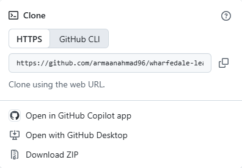

Find the ZIP in your Downloads folder. On Windows, right-click it and choose **Extract All**. On a Mac, double-click it. You now have a folder called `lead-finder-main`. Move it somewhere easy, like your Documents.

**If you already use Git:**

```sh
git clone https://github.com/wharfedale-ai/lead-finder.git
```

### 2. Install Node.js

Node.js is the free engine the app runs on. Go to [nodejs.org/en/download](https://nodejs.org/en/download), pick your system, and click the green **Installer** button at the bottom (on Windows: **Windows Installer (.msi)**). Ignore the code box in the middle; you do not need it.

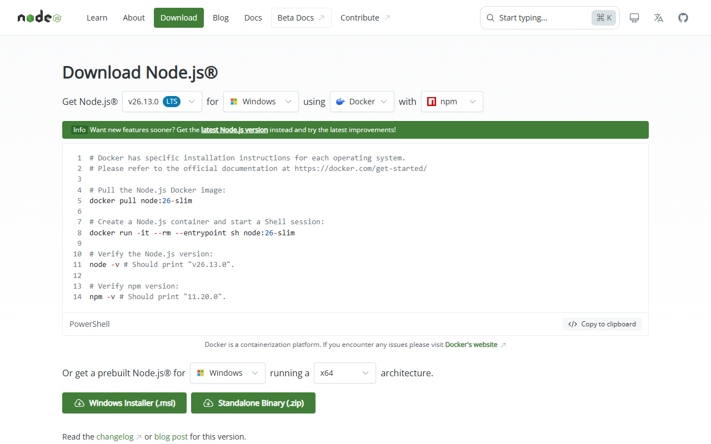

Open the file you downloaded and click **Next** until it finishes. Keep the default options. You need version **18.18 or newer**; the current LTS version is fine.

### 3. Start the app

Open the project folder and double-click:

- **Windows:** `start.bat`
- **Mac:** `start.command` (the first time, right-click it and choose **Open**, then **Open** again, because macOS is careful with downloaded files)
- **Linux:** run `./start.sh` in a terminal

A small black window opens. The first time, it spends a minute installing the app's few building blocks. Then your browser opens at `http://127.0.0.1:4310`. That address only works on your own computer.

**Keep the black window open while you use the app.** Closing it stops the app.

<picture><source media="(prefers-color-scheme: dark)" srcset="docs/images/01-start-dark.png">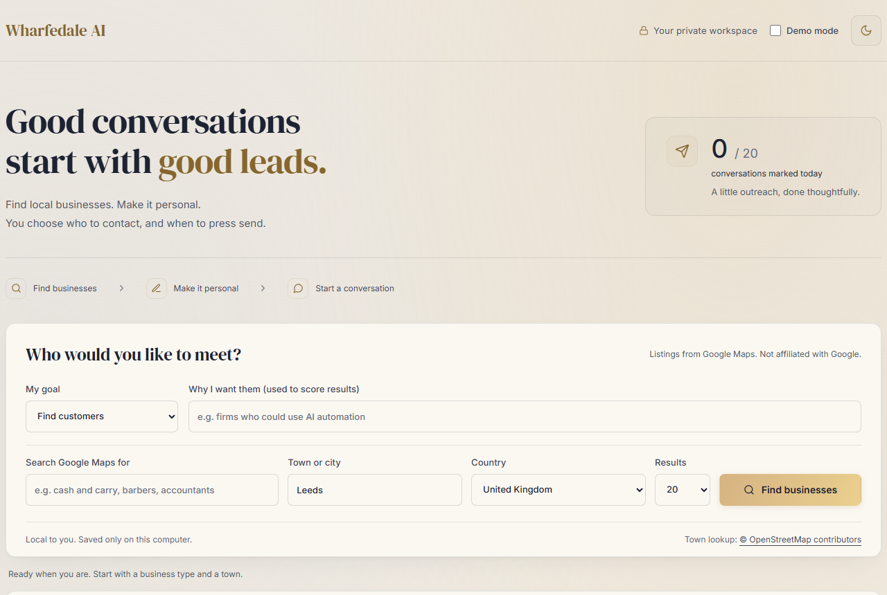</picture>

### 4. Your first search, in Demo mode

Tick **Demo mode** at the top right. Everything you now see is made up: fake companies, `example.com` websites and TV drama phone numbers. Nothing goes on the internet, and your real list is untouched.

Fill in the form:

1. **My goal:** *Find customers* (people you sell to) or *Find suppliers / partners* (people you buy from or work with).
2. **Why I want them:** one plain sentence. The app uses it to score each business and to write your message. Example: *UK manufacturers of corrugated cardboard boxes who can do small runs*.
3. **Search Google Maps for:** the kind of business, like *packaging manufacturers*, *barbers* or *accountants*.
4. **Town or city**, **Country** and how many **Results** (20 to 100).
5. Click **Find businesses**.

<picture><source media="(prefers-color-scheme: dark)" srcset="docs/images/02-demo-search-dark.png">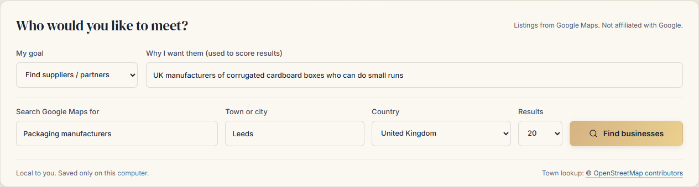</picture>

Demo mode always shows the same example packaging firms, whatever you type. In real use (Demo mode off), the first search downloads a free search tool of about 70 MB once. That can take a minute.

### 5. Read your shortlist

Each business gets a **fit score out of 100**, best first, with a short reason underneath. Untick anyone you are not interested in. Big chains (Tesco, Costa and so on) are hidden; tick **Show chains** to see them.

<picture><source media="(prefers-color-scheme: dark)" srcset="docs/images/03-shortlist-dark.png">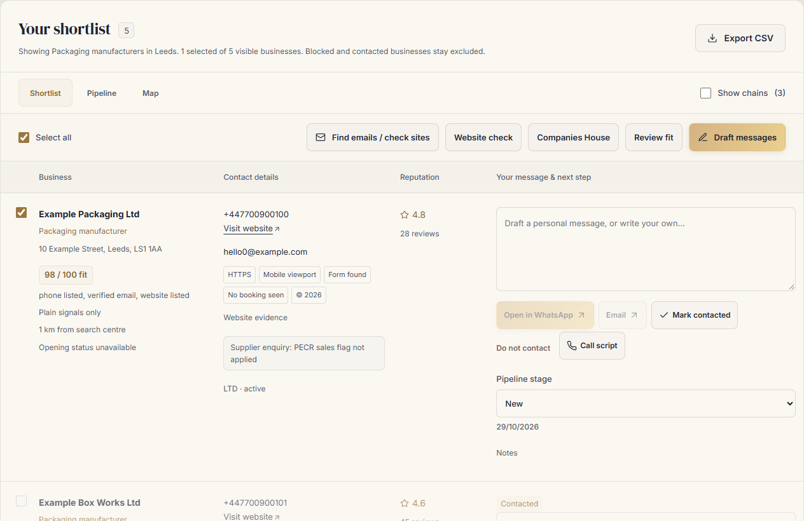</picture>

The moon or sun button at the top right swaps between dark and light colours.

### 6. Find emails

Tick the businesses you want, then click **Find emails / check sites**. The app reads each business's own website (home page plus up to three contact, about or privacy pages) and shows any email address it publishes. It never guesses emails. Small chips tell you about the website: secure (HTTPS), works on phones, has a contact form, how old it looks.

<picture><source media="(prefers-color-scheme: dark)" srcset="docs/images/04-emails-dark.png">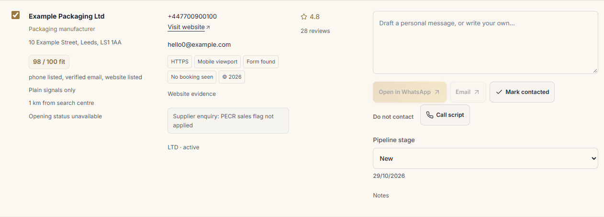</picture>

### 7. Make it sound like you

Scroll to the bottom and open **Make it sound like you**. Type your name or business and what you help with, then click **Save message settings**. Every draft uses these.

<picture><source media="(prefers-color-scheme: dark)" srcset="docs/images/08-settings-dark.png">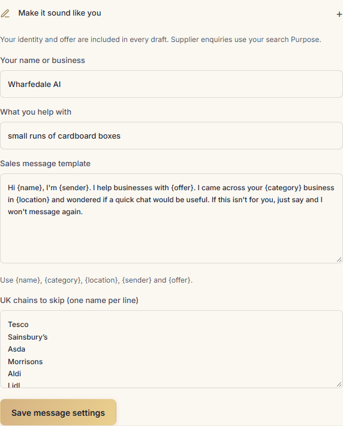</picture>

### 8. Draft a message

Click **Draft messages**. First a box tells you what it will cost. Without a Claude key it is **free** and uses a template. With a key it is a few pence.

<picture><source media="(prefers-color-scheme: dark)" srcset="docs/images/05-cost-dark.png">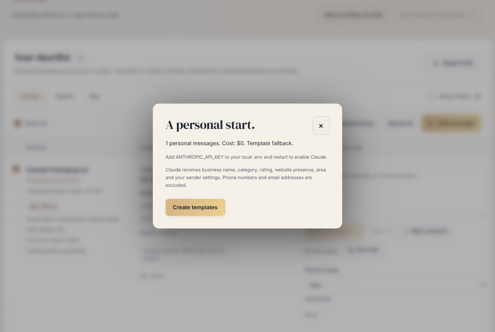</picture>

Click to confirm. A draft appears next to each business. **Read it and change anything you like**; it is just a text box. **Call script** writes a short phone opener instead.

<picture><source media="(prefers-color-scheme: dark)" srcset="docs/images/06-draft-dark.png">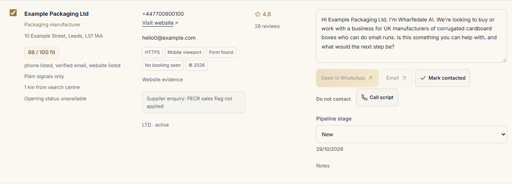</picture>

### 9. Send it yourself

- **Open in WhatsApp** opens WhatsApp (Desktop or Web) with your message ready. **You press send.**
- **Email** opens your email app with the message filled in. **You press send.**
- Then click **Mark contacted**, so you never message the same business twice.

These buttons are greyed out in Demo mode on purpose, and for any business that needs consent first (see step 11). **Do not contact** blocks a business for good, across every future search. Use it the moment anyone says no.

You can mark up to **20 contacts a day** before the app asks if you are sure. Slow and personal works better than spam.

### 10. Track replies in the pipeline

Click **Pipeline**. Each business sits in a column: New, Contacted, Replied, Meeting, Won or Lost. Change the stage from the dropdown; the date is saved. Open **Notes** to jot things down.

<picture><source media="(prefers-color-scheme: dark)" srcset="docs/images/07-pipeline-dark.png">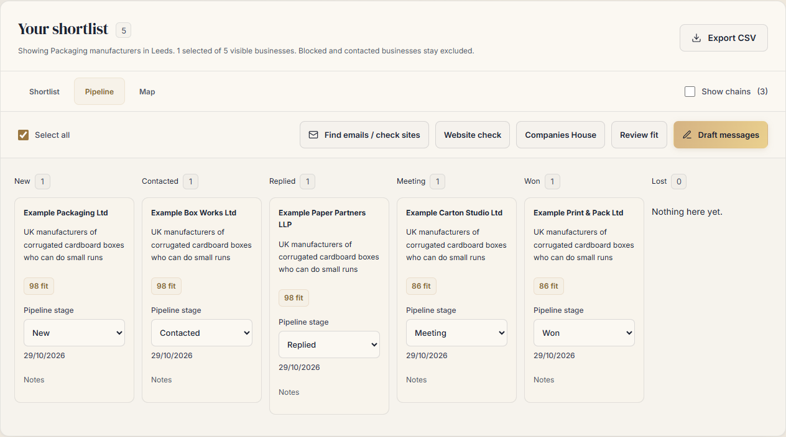</picture>

If someone has not replied after **3 days**, a *Follow up today* strip reminds you. You get **one** follow-up. After that the app suggests moving them to Lost, so nobody gets pestered.

**Map** shows the businesses as pins, coloured by fit.

On a phone-sized screen everything stacks into one column:

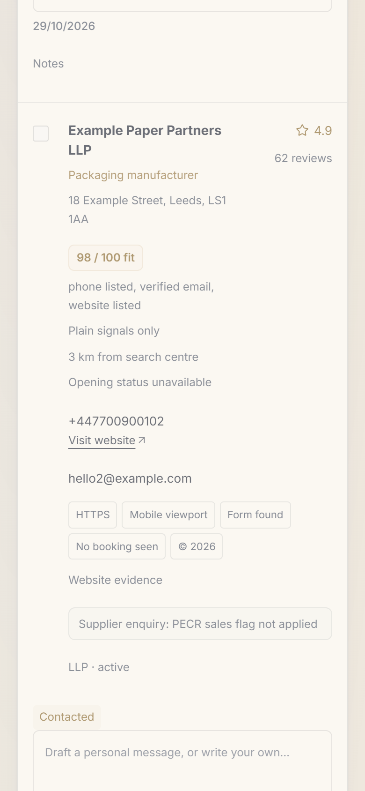

### 11. UK rules (PECR) in plain words

PECR is the UK law about marketing by email, text and WhatsApp. In short:

- **Limited companies, LLPs and PLCs:** you may send a sales message if you say who you are and give an easy way to say no. The app adds that line for you.
- **Sole traders and partnerships:** **you need their consent first** for WhatsApp, text or email sales messages. Phone them or write a letter instead.
- **Not sure what they are?** Treat them as needing consent. The app does this for you: the WhatsApp and Email buttons stay off until a Companies House check confirms an active limited company, or you tick that you have consent.
- **Phone calls** have their own rules: check the business is not on the TPS or CTPS do-not-call lists.
- **Every no is final.** Put them on Do not contact straight away.
- Asking a supplier to sell to you is not a sales message, so the app labels supplier enquiries differently.
- Public contact details are not consent, and personal data (like a director's name) still needs care.
- **If you keep a person's details** (for example a sole trader's), UK GDPR makes you responsible for them. In your first message, say who you are, where you found their details and how to opt out. Delete leads you no longer need.
- **You are responsible for how you use the listings.** Google's terms limit automated collection and bulk copying of Maps content. Keep searches small and for your own research.

This is a plain summary, not legal advice. The official guide is the [ICO's business-to-business marketing page](https://ico.org.uk/for-organisations/direct-marketing-and-privacy-and-electronic-communications/business-to-business-marketing/).

### 12. Optional: add keys for smarter features

Everything above works free with no keys. Two optional keys add more:

| Key | What it adds | Where to get it | Cost |
|---|---|---|---|
| `COMPANIES_HOUSE_API_KEY` | Checks if a business is a real, active limited company and who the directors are. Unlocks the WhatsApp/Email buttons for those companies. | [Companies House developer hub](https://developer.company-information.service.gov.uk/) | Free |
| `ANTHROPIC_API_KEY` | Claude writes personal messages and call scripts, and judges fit against your reason. | [console.anthropic.com](https://console.anthropic.com/) | Pay as you go, a few pence per batch. The app shows the cost first. |

To add them:

1. In the project folder, copy `.env.example` and name the copy `.env`. (On Windows, if renaming is awkward, open Notepad, paste the lines below and **Save as** `.env` with "All files" selected.)
2. Paste your key after the `=` sign, with no spaces:
   ```
   ANTHROPIC_API_KEY=your-key-here
   COMPANIES_HOUSE_API_KEY=your-key-here
   ```
3. Close the black window and start the app again.

**Never share your `.env` file or paste a key into the web page.** The `.env` file stays on your computer and is never uploaded.

### 13. Troubleshooting

| What you see | What to do |
|---|---|
| "Install Node.js 18.18 or newer" | Do step 2, then restart your computer and try again. |
| Windows says "Windows protected your PC" | Click **More info**, then **Run anyway**. It appears because the file came from the internet. |
| Mac says it cannot open `start.command` | Right-click it, choose **Open**, then **Open**. If it still refuses, open Terminal in the folder and run `chmod +x start.sh start.command`. |
| The browser did not open | Open your browser yourself and go to `http://127.0.0.1:4310`. |
| The page will not load, or the black window shows an "address in use" error | The app is probably already running in another black window. Close the extra one. Or add `PORT=4311` to `.env`. |
| The first real search is slow | It is downloading the search tool once (about 70 MB). Later searches are quicker. |
| Search says your computer is not supported | The search tool supports normal Intel/AMD Windows, Mac and Linux. Apple Silicon Macs need Rosetta 2. Windows or Linux on ARM is not supported. |
| No emails found | Many small businesses do not publish one. The app never guesses. Use WhatsApp or the phone instead. |
| The WhatsApp button is grey | You are in Demo mode, the business needs consent (step 11), it is on Do not contact, or it has no usable number. |

### 14. Stop the app

Close the black window (or click in it and press **Ctrl+C**). Your shortlist, pipeline and Do not contact list are saved in a private folder on your computer (`.wharfedale-lead-finder` in your user folder) and will be there next time. To use it again, double-click the launcher.

---

## Reference (full detail)

### Run from a terminal

```sh
npm ci
npm start
```

Open the address printed in your terminal. Keep that terminal open. Stop with Ctrl+C. On Unix, make the launchers executable once if your download did not preserve permissions: `chmod +x start.sh start.command`.

Copy `.env.example` to `.env`, add only the keys you want to use, and restart. Environment variables take precedence. Never put a key in the page or commit `.env`. `PORT` changes the local port. `NOMINATIM_URL` can switch to another compatible geocoding service without an app update.

The first real search downloads the pinned [gosom/google-maps-scraper v1.18.1](https://github.com/gosom/google-maps-scraper/releases/tag/v1.18.1), about 60 to 77 MB, into your user data directory. Both release size and SHA-256 are verified before execution and on reuse. FAST mode is the only mode used. It installs no browser. Searches use a 10 km radius and can return fewer than the requested maximum of 20 to 100.

The release supplies x64 Windows, Linux and macOS binaries. Apple Silicon can run the macOS binary through Rosetta 2. Native Linux/Windows ARM is not supported by this pinned release; the app explains this instead of running an incompatible binary. The web app itself uses portable Node.js APIs.

### Research workflow

1. **Purpose first.** Choose customers or suppliers / partners. Save what you are looking for with the search. Earlier leads remain in the pipeline when you run a new search.
2. **Shortlist.** Fit is sorted highest first. Untick unwanted businesses. Chains are hidden by default; show them with the toggle or edit the chains list in settings. Three identical normalised names also count as a chain.
3. **Website evidence.** Website check has a five-second total budget per site. Find emails checks the home page and up to three linked contact, about or privacy pages, each with a five-second fetch limit. Both use the same browserless, robots-aware fetcher, with at most two websites in progress. A failed robots request skips the site; 404 or 410 means no published restrictions. Long crawl delays skip the site. Redirect destinations get their own robots check. Private/local addresses, non-HTTP protocols and oversized pages are blocked.
4. **Fit.** The plain score uses reachable contact details, web presence, rating, reviews, known opening status, chains and distance. Customer mode raises need-related signals; supplier mode favours a strong presence. Review fit optionally adds Claude's purpose judgement, 10 leads per call, 60% Claude and 40% plain. Every paid action shows an estimate first. Judgements are cached by place, purpose and website snippet. Missing opening status and web evidence remain unknown.
5. **Company identity.** [Companies House developer hub](https://developer.company-information.service.gov.uk/) provides free API keys. Matches require one exact normalised name and postcode match. Ambiguous/no matches stay unknown; absence does not prove a sole trader. Only officer names, roles and active status are stored, never officer/home addresses. A director's first name is supplied to Claude only when exactly one active director is verified.
6. **Messages and calls.** Claude uses the purpose, listing, website snippet and sender settings. Customer messages identify the sender and end with an opt-out. Supplier enquiries ask about buying or working together without a sales opt-out. Drafts remain editable. Call scripts use the same purpose, with a free template fallback. Claude errors are shown or use a clearly identified fallback; they never silently switch models.
7. **Manual contact.** Opening a message does not mark it sent. Press send yourself, then mark contacted. Sales WhatsApp/email links require a verified active Ltd, LLP or PLC match, or your recorded consent confirmation. A stored opt-out blocks contact regardless of company status or consent. Phone calls have their own rules, including TPS/CTPS screening where applicable.
8. **Pipeline.** New, Contacted, Replied, Meeting, Won and Lost. Stage changes are dated. Add private notes. After three days in Contacted with no reply, the reminder offers one manual follow-up. Mark it only after sending or speaking. A second follow-up is blocked, and after three more days the app suggests Lost. Marking contacts has a daily soft cap of 20, with an explicit override.
9. **Map.** Leaflet uses free OpenStreetMap tiles when you explicitly open the real map view. Pins show fit colour and open the matching lead. Missing coordinates are not geocoded or guessed. Tile requests share your IP and viewed map area with OpenStreetMap. Demo uses a local illustrative map instead.

### UK marketing guidance

For electronic sales marketing, approach verified corporate subscribers with clear sender identity and an opt-out. Sole traders and most partnerships need consent. Personal data also needs a lawful basis and transparency; public contact details alone are not consent. A company match is an identity signal, not a blanket legal approval. The app uses a conservative flag for missing, ambiguous or dissolved matches. See the [ICO's business-to-business guidance](https://ico.org.uk/for-organisations/direct-marketing-and-privacy-and-electronic-communications/business-to-business-marketing/).

Nominatim is used only for user-triggered town lookups, with an identifying User-Agent, cached results, visible attribution and at least 1.1 seconds between requests. No autocomplete or bulk geocoding. The public endpoint is for this modest local use, not a hosted service at scale. Follow the [Nominatim usage policy](https://operations.osmfoundation.org/policies/nominatim/) and change the endpoint before a wider rollout if required. The map respects the [OpenStreetMap tile policy](https://operations.osmfoundation.org/policies/tiles/): attributed tiles, normal browser caching, no prefetch or offline downloads.

### Data and recovery

`state.json` holds searches, leads, archived pipeline entries, purpose, notes, contact log, consent records, fit cache and the do-not-contact list. Every real write first copies the previous file to `state.json.bak`, then atomically replaces `state.json`. Raw scraper results live in the user's `searches/` subfolder. Keys are read at startup and never stored in this data. Demo state is separate in memory, reset when demo is re-enabled, and never written to real files. Restart always opens the real workspace.

Back up the whole data folder to keep the contact and suppression history. If the saved file is unreadable, startup stops instead of silently clearing history. Stop the app, preserve the damaged file, and restore `state.json.bak` as `state.json`. Do not run two app instances against the same data directory.

### Verification

```sh
npm test
npm run test:ui
```

Unit/integration tests use synthetic data, mocked external APIs and isolated temporary directories. UI checks use installed Chrome on Windows, or Playwright Chromium elsewhere (`npx playwright install chromium`). Set `LEAD_FINDER_BROWSER_CHANNEL` to another supported channel if needed. UI checks block external requests, use demo mode, and write screenshots at 1440 and 390 pixels into `reports/` (not committed).

`node scripts/tutorial-shots.mjs` retakes the tutorial screenshots in `docs/images/`, in Demo mode with external requests blocked.

`node scripts/live-smoke.mjs` is an explicit real search check against Nominatim and Maps, in an isolated temporary data folder. It never opens contact links. It writes only aggregate counts, into `reports/` (not committed).

Four runtime dependencies: `entities`, `libphonenumber-js`, `robots-parser`, `leaflet`. Playwright is development-only. Inter and DM Serif Display are bundled locally under the SIL Open Font Licence; see `public/fonts/`. No font requests leave the app during use.

### Licence and third-party software

Lead Finder is released under the [MIT licence](LICENSE), Copyright (c) 2026 Wharfedale AI. It comes with no warranty.

- **Search tool:** [gosom/google-maps-scraper](https://github.com/gosom/google-maps-scraper) v1.18.1, MIT, Copyright (c) 2023 Georgios Komninos. It is not included in this repository. Your copy is downloaded from its official GitHub release on your first real search, checked, and run with its anonymous usage statistics turned off (`DISABLE_TELEMETRY=1`). Its own notice warns that unauthorised scraping may violate terms of service.
- **Libraries:** Leaflet and entities (BSD-2-Clause), libphonenumber-js and robots-parser (MIT).
- **Fonts:** Inter and DM Serif Display, SIL Open Font Licence (see `public/fonts/`).
- **Data:** map tiles and town lookups © OpenStreetMap contributors (ODbL). Company details from Companies House under the Open Government Licence.
- Google and Google Maps are trademarks of Google LLC. This project is not affiliated with, endorsed by or sponsored by Google.
